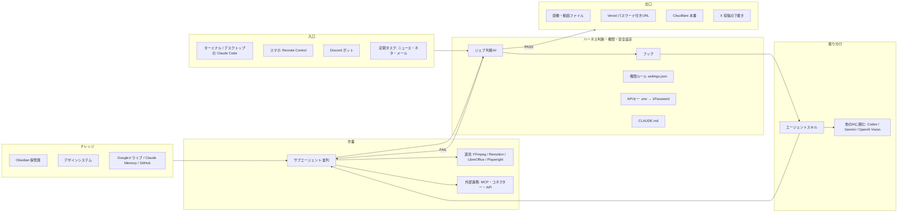

# AIエコシステム図鑑

入口は Claude Code ひとつ。依頼はまず「ハーネス（判断・権限・安全設定）」を通り、種類ごとにスキルや他のAIへ振り分けられる。
作業はサブエージェントが並列で進め、ナレッジとデザインシステムを参照する。ジェブ（判断AI）の検品を通ったものだけが出口に出る。

> このリポジトリは公開（public）。私的なメモの置き場所は `knowledge/README.md` と `SETUP.md` 5章を参照。

この図鑑と `SETUP.md` を Claude Code に渡して「この環境を作りたい」と頼めば、足りない手順を案内してもらえる。
ほかのプロジェクトでも使いたいときは、`node ai-ecosystem/scripts/install-global.mjs` で PC 全体に入れられる（`SETUP.md` 12章）。



## 動画で紹介された要素と、このリポジトリでの再現

状態の見方:

- **済**: このリポジトリを Claude Code で開けばすぐ動く
- **要キー**: 仕組みは入っていて、APIキーを足せば動く
- **要接続**: claude.ai のコネクター接続が必要（今の claude.ai アカウントでは接続済み）
- **要PC設定**: 自分のPCやアカウントでの設定が必要（`SETUP.md`）
- **一部** / **未実装**: 動画と同じ形にはなっていない（理由を表に書いた）

### 1. 入口

| 動画の要素 | 再現したもの | 状態 |
| --- | --- | --- |
| 入口はほぼ Claude Code だけ | このリポジトリ全体（CLAUDE.md・フック・スキル） | 済 |
| ターミナルで Claude Code を動かす（デスクトップアプリでも可） | リポジトリのフォルダで `claude` を起動 | 要PC設定 |
| スマホアプリの Remote Control で遠くのPCを操作 | `SETUP.md` 2章 | 要PC設定 |
| Discord ボットがやり取りをまとめる | `bots/discord-digest.mjs`（Discord を読んで要約を投稿する一方向のボット。Discord から Claude Code に作業を頼む入口は作っていない） | 一部・要キー |
| 定期タスクでニュース・YouTubeネタ・メールを毎日まとめる | `.claude/skills/daily-digest` ＋ 定期実行の登録 | 要PC設定 |

### 2. ハーネス判断・権限・安全設定

| 動画の要素 | 再現したもの | 状態 |
| --- | --- | --- |
| 判断AI「ジェブ」を全部のやり取りに挟む | 人間→AI: 依頼のたびに判断手順を差し込む `.claude/hooks/route-prompt.mjs`。AI→サブエージェント: 各スキルの手順の中で検品役 `.claude/agents/jeb-judge.md` を呼ぶ（フックで自動的に挟む形ではない） | 一部 |
| 段取りは妥当か、成果物は100%か毎回判断させる | 検品前の終了を1回止める `.claude/hooks/stop-judge.mjs`、合格基準 `knowledge/rules/review.md` | 済 |
| ジェブのAPI呼び出し | `scripts/judge-text.mjs`（Claude API、別のAIの意見として） | 要キー |
| 画像の判断は OpenAI Vision API（崩れた文字・個人情報・矢印） | `scripts/judge-image.mjs` | 要キー |
| フック: 文章を書くときに必ずジェブが起動 | `.claude/hooks/style-check.mjs`（NG表現・AIっぽいデザインを自動指摘） | 済 |
| フック: 完成してメモを取る場面で Obsidian に登録 | `.claude/hooks/session-memo.mjs`、`.claude/skills/obsidian-memo` | 済（Obsidian は要PC設定） |
| フック: 特定フォルダの削除を強制的に止める | `.claude/hooks/guard.mjs`（保護フォルダは停止、それ以外の削除は人間に確認） | 済 |
| 権限ルール（settings.json）: 削除NG、外部サービス上の削除は絶対ダメ | `.claude/settings.json` の deny / ask、`guard.mjs`（MCP の削除・消去は停止、送信・課金・公開・共有は確認、安全設定ファイル自体の書き換えも確認） | 済 |
| APIキーは .env に 1Password の参照だけ（漏れても大丈夫） | `.env.example`、`scripts/with-secrets.sh`（`op run`） | 要PC設定 |
| CLAUDE.md: きれいな日本語、メモのルール、ジェブで判断、AIっぽいデザイン禁止、成果物は必ず見直す | `CLAUDE.md` ＋ 別メモ `knowledge/rules/*.md` を読み込む形 | 済 |

### 3. 振り分け・スキル・ナレッジ

| 動画の要素 | 再現したもの | 状態 |
| --- | --- | --- |
| 他のAIに頼むルート（画像生成→Codex のイメージ生成） | `.claude/skills/ask-other-ai`、`scripts/ask-codex.sh`、予備 `scripts/image-generate.mjs` | 要PC設定 |
| 動画生成・Google Workspace・長い文章や動画のレビュー→Antigravity（Gemini） | `scripts/ask-gemini.sh`（`GEMINI_CMD` で Antigravity にも切替） | 要PC設定 |
| 大量のエージェントスキル（動画・画像・スライド・議事録・Web/ブログ/書籍・事務・SNS） | `.claude/skills/` の14スキル（一覧は `knowledge/skills/skill-catalog.md`。書籍は `book-manuscript`） | 済 |
| 小さいスキルを組み合わせて大きなタスクをこなす | `planner` サブエージェントが段取り表でスキルを組み合わせる | 済 |
| 案件ごとにスキルを分ける（A社用・B社用スライド） | `design-systems/<案件>/`、私的用の保管庫の `clients/<案件>.md`、`slides-<案件>` への複製手順 | 済 |
| スキルごとにサブエージェントでチェック | 各スキルの最後に `quality-inspector` / `jeb-judge` | 済 |
| Claude Memory（これまでのやり取りの蓄積） | Claude Code の自動メモリ（そのまま使う） | 済 |
| Obsidian に AI 用メモを大量に格納 | `knowledge/`（そのまま Obsidian の保管庫として開ける） | 済 |
| Googleドライブをナレッジとして参照 | Google Workspace コネクター | 要接続 |
| デザインシステムで雰囲気を固定、案件別に保持 | `design-systems/default`（青系）と `_template` | 済 |
| GitHub で元コードを複数PC・作業者で共有 | このリポジトリ（`web-publish` スキルにも手順） | 済 |

### 4. 外部連携・API・サブエージェント・道具

| 動画の要素 | 再現したもの | 状態 |
| --- | --- | --- |
| Google Workspace コネクター（Gmail・ドライブ・カレンダー） | claude.ai のコネクター | 要接続 |
| Slack・Discord・Notion | claude.ai のコネクターで追加 | 要接続 |
| マネーフォワード（請求書・仕訳・資産表） | `.claude/skills/invoice-moneyforward`（接続は各自） | 要PC設定 |
| Figma（ワイヤーフレーム・イメージ図） | claude.ai のコネクター | 要接続 |
| 動画生成 API（Seedance など） | 呼び出しスクリプトは未作成。`ad-video` スキルに「使うサービスを決めたらスクリプトを足す」と組み込む位置だけ書いた | 未実装 |
| 音声（ElevenLabs / Google TTS）でナレーション | `scripts/tts-elevenlabs.mjs`（ElevenLabs のみ。Google TTS は未対応） | 一部・要キー |
| サブエージェントの並列処理（テロップ担当・品質確認・プランナー） | `.claude/agents/` の5体（jeb-judge / planner / quality-inspector / japanese-editor / telop-writer） | 済 |
| 動画: HyperFrames・Remotion・FFmpeg | `ad-video` / `video-edit` スキル | 要PC設定（FFmpeg 以外） |
| スライド: LibreOffice で確認 | `slides` スキル、`quality-inspector` | 要PC設定 |
| Web: Playwright でブラウザ操作・確認 | `.mcp.json`（Playwright MCP） | 済 |
| ブログ更新: Markdown 用 MCP | 専用の MCP は入れていない。記事は Markdown ファイルとして書き出し、ブログのリポジトリに置く（`blog-article` 手順9） | 未実装（代替あり） |
| X 投稿: X API | `sns-post` スキル、`.env.example` | 要キー |

### 5. 出口と業務フロー

| 動画の要素 | 再現したもの | 状態 |
| --- | --- | --- |
| 画像・動画ファイルの出力 | `ai-ecosystem/output/<案件>/`（Git には入れない） | 済 |
| Vercel にパスワード付きURLでデプロイ | `web-publish` スキル（Vercel のコネクターか CLI） | 要接続・要PC設定 |
| Cloudflare で独自ドメインのブログに本番反映 | `web-publish` スキル | 要PC設定 |
| X は Claude in Chrome で下書きまで作り、人間が確認して投稿 | `sns-post` スキル | 要PC設定 |
| 事例①: ブログ記事が1本できるまで | `blog-article` スキル | 済 |
| 事例②: 広告用動画（静止画で確かめてから動画化、Gemini と ジェブで検品） | `ad-video` スキル | 要キー・要PC設定 |
| 事例③: 請求書の発行（お金なので途中で人間に確認） | `invoice-moneyforward` スキル | 要PC設定 |

### 6. 補足

| 動画の要素 | 再現したもの | 状態 |
| --- | --- | --- |
| 別の入口のチャットボット（中で Claude Code が動く、1Password を持たせてパスワードを見せずにログイン） | 今回は作っていない。代わりにクラウドの Claude Code（claude.ai/code）と Remote Control を使う（`SETUP.md` 11章） | 要PC設定 |
| チーム用 Discord ボット（日次レポート、権限は本人とパートナーのみ） | `bots/discord-digest.mjs`（報告は非公開チャンネルへ） | 要キー |

## フォルダ構成

```
CLAUDE.md                  … 全体ルール（rules/*.md を読み込む）
.claude/
  settings.json            … 権限ルール、フック、ステータスラインの登録
  statusline.mjs           … 画面の下に週間・5時間の利用制限を常に表示（携帯用に Obsidian へも書き出す）
  hooks/                   … route-prompt / guard / style-check / stop-judge / session-memo
  agents/                  … jeb-judge / planner / quality-inspector / japanese-editor / telop-writer
  skills/                  … 14のエージェントスキル
.mcp.json                  … Playwright MCP
.env.example               … 1Password 参照の見本（.env は Git に入れない）
ai-ecosystem/
  README.md                … この図鑑
  SETUP.md                 … 自分のPCでやる設定
  scripts/                 … 判定AI・画像判定・音声・画像生成・他AI呼び出し・1Password 連携、PC全体に入れる install-global.mjs
  global/CLAUDE.md         … PC全体に入れたときのルール（~/.claude/jeb/CLAUDE.md になる）
  bots/discord-digest.mjs  … Discord の日次まとめ
  knowledge/               … Obsidian の保管庫（ルール・NG辞書・スキルのコツ・ネタ帳・案件メモ）
  design-systems/          … default と案件用の雛形
  output/                  … 成果物の出力先（Git 管理外）
```

## 一時的に止めたいとき

| 止めたいもの | 方法 |
| --- | --- |
| 依頼ごとの判断手順の差し込み | 環境変数 `JEB_ROUTER=off` |
| 文体・デザインの自動チェック | `JEB_STYLE_CHECK=off` |
| 終了前の検品ゲート | `JEB_STOP_GATE=off` |
| フック全部 | Claude Code の `/hooks` で確認・無効化 |

逆に、もっと厳しくしたいときは `JEB_MCP_STRICT=on` にする。外部サービス（MCP）への読み取り以外の操作が、すべて人間の確認待ちになる。

## ガードが止めるもの・確認するもの

### このPCの中のファイルと Git

| 操作 | 扱い |
| --- | --- |
| 保護フォルダ（`.git`・`.claude`・`.env`・`CLAUDE.md`・`knowledge`・`design-systems`）の削除・移動 | 停止 |
| ルート・ホーム・プロジェクト全体の削除、`.env` への書き込み | 停止 |
| 強制 push（`-f`・`--force-with-lease`・`--mirror`・`+ブランチ`）、リモートの枝の削除（`--delete`・`:ブランチ`） | 停止 |
| `git clean -x`（範囲の指定なし）: Git に入っていない `.env`・私的メモ・原稿まで消える | 停止 |
| それ以外のファイル削除（`rimraf` などの削除ツール、`ai-ecosystem/output/` の原稿や動画も含む） | 確認 |
| 安全設定（`.claude/settings*.json`・`.claude/hooks/`・ユーザー全体の `~/.claude/settings*.json`）の書き換え | 確認 |
| 安全設定を含む場所への上書き（`cp -r`・`rsync`・`git checkout`・`git restore`・`git apply`・`tar -x`・`unzip`、プログラムの中の書き込み） | 確認 |
| ふつうの `git push`（作業ブランチへの反映） | そのまま通す |
| プロジェクト内のビルド成果物（dist・build など）と一時フォルダの削除 | そのまま通す |

### 外部サービス

| 操作 | MCP（コネクター）経由 | コマンド（CLI）経由 |
| --- | --- | --- |
| 削除・消去 | 停止（delete・trash・clear など、ゴミ箱ラベル、`trashed: true`、SQL ツールでの `DROP TABLE`・`DELETE FROM`） | 停止（`gh … delete`・`gh api -X DELETE`・`vercel remove`・`wrangler delete`・`curl -X DELETE`・DB コマンドでの削除 SQL・`supabase db reset` など） |
| 送信・公開・課金・共有・招待・コメント・設定変更 | 確認（GitHub への書き込みはすべて確認） | 確認（`gh pr merge`・`gh repo create/edit`・`gh release create`・`gh api` での書き込み・`vercel --prod`・`wrangler deploy` など） |
| 外部へのデータ送信（投稿 API・Webhook など） | 上の行と同じ | 確認（`curl` の POST・PUT・PATCH、`-d`・`-F` など。localhost は対象外） |
| ネットから取ってきたスクリプトをそのまま実行（`curl … \| bash`） | — | 確認 |
| 読み取り | そのまま通す | そのまま通す |

ガードがコマンドを読む範囲は次のとおり。

- `( )`・`{ }`・`if`・`for` の中
- `sudo`・`env`・`timeout`・`xargs`・`npx` などを前に付けた形、`git -C`
- `bash -c`・`eval`・`$( )`・`<( )` の中と、`cd` したあとのコマンド
- `node -e`・`python -c` の中の削除・書き込み・コマンド実行
- シェルや Python に渡すヒアドキュメントとパイプ（`bash <<EOF`・`echo … | bash`）
- 端末操作系の MCP（desktop-commander など）経由のコマンド、ファイル操作、対話画面に送るコード

**ガードの限界（対象外）**: ガードはコマンドの文字列を読んで判断する網であり、完全な防御ではない。次のようなものは見えない。

- スクリプトファイルの中で行う処理（`node script.js`、`npm run` の中身、`make` など）
- 変数や別名を組み合わせて、実行するまで中身が決まらない書き方（`git config alias` で作った別名など）
- 表にない CLI での外部操作（その場合は Claude Code の通常の許可確認に任せる）
- ブラウザ操作（Playwright MCP・Claude in Chrome）での削除ボタンや投稿ボタンのクリック。`sns-post` スキルは、投稿ボタンを押さずに下書きで止める手順にしてある
- コードを実行する MCP の中身（Figma の `use_figma` で要素を消すコードなど）

最後の守りは Git の履歴とバックアップ。大事なファイルはコミットしておく。
